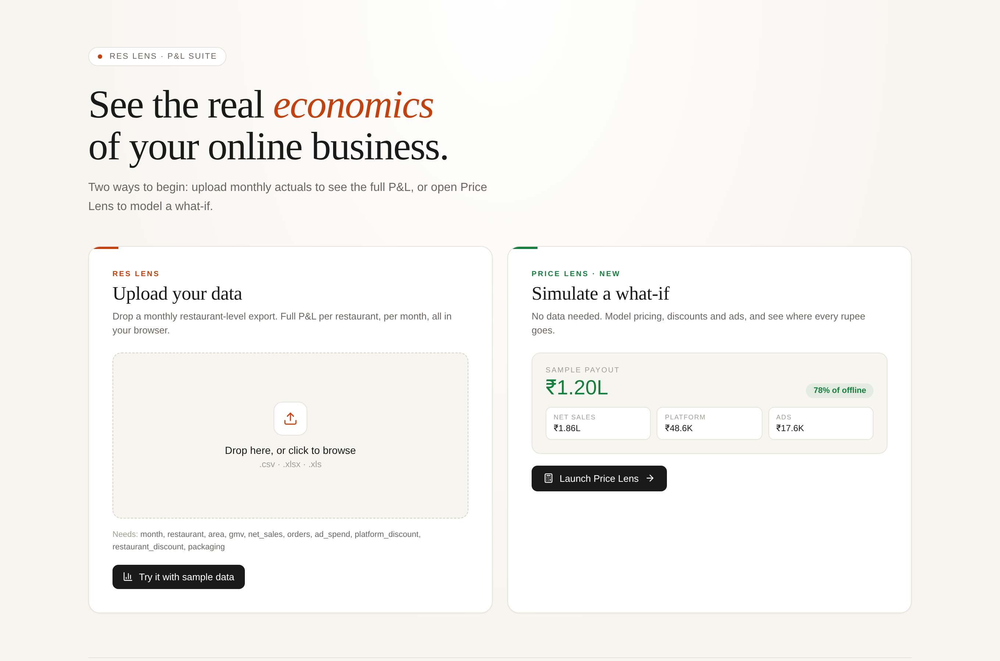
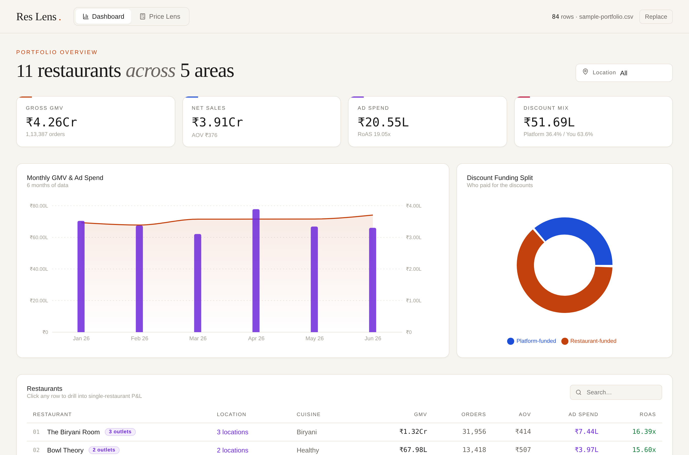
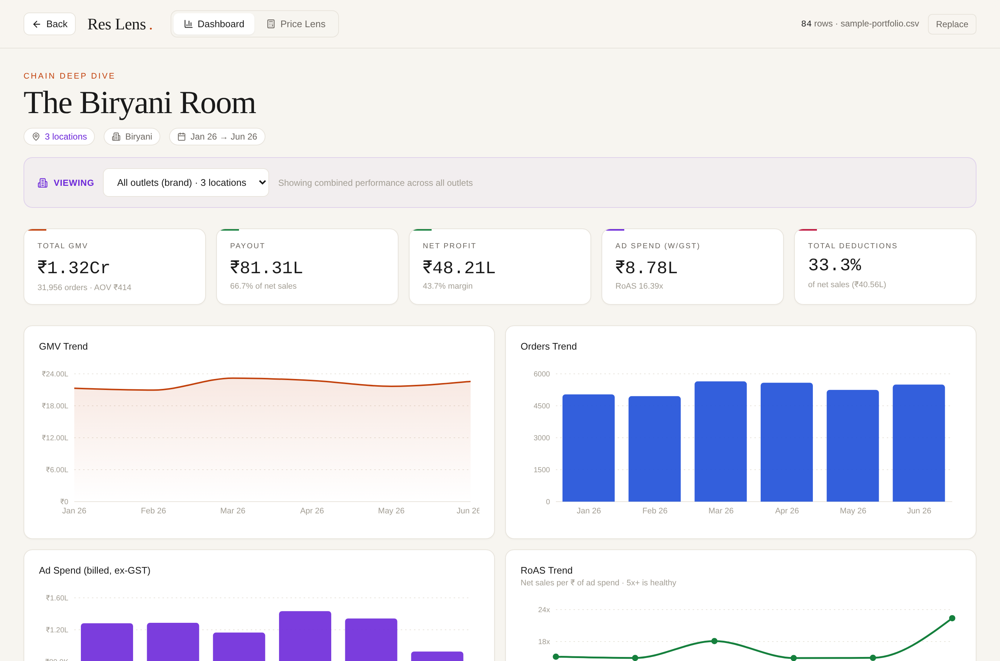
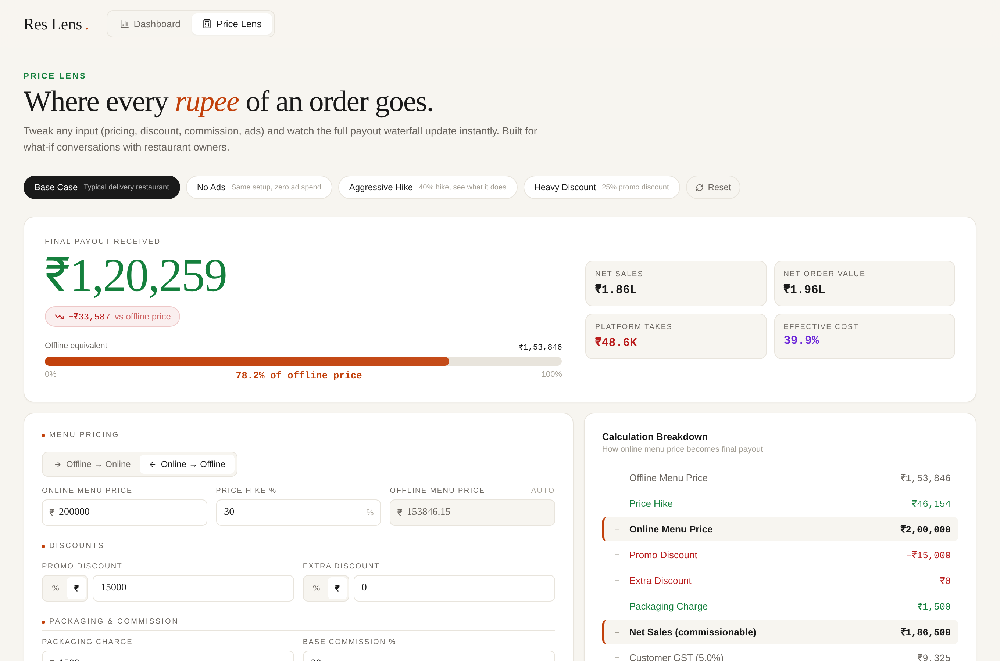

# Res Lens

**What does a restaurant actually take home from its delivery orders?**

Res Lens turns a monthly restaurant-level export into a full P&L: from GMV, through discounts and platform fees, to the payout that lands in the bank and the profit left after food cost. It works across a whole portfolio of restaurants, and drills into any single restaurant or outlet.

It ships with **Price Lens**, a payout calculator for what-if conversations: change the price, the discount, the commission or the ad budget, and watch every rupee move.

**[Live demo](https://AnshGupta6378.github.io/Res-lens-P-L/)**: click **Try it with sample data** to explore without uploading anything.



## Why I built it

Restaurant owners rarely see their delivery business as one clear P&L. Sales, discounts, commission, payment gateway fees, GST and ads all show up in different places, so "Is it worth it?" and "What happens if I raise prices?" are hard to answer on the spot. I wanted one screen that answers both, with numbers the owner can check line by line.

## What's inside

### Portfolio dashboard
GMV, net sales, ad spend and RoAS across every restaurant, a monthly trend, and who funded the discounts (the platform or the restaurant). Filter by area, search, and click any restaurant to open its P&L.



### Restaurant deep dive
- Monthly P&L from GMV down to net profit, with every deduction shown
- Chains get an outlet picker: see the brand combined, or one outlet at a time
- **Re-pricing impact:** pick a price change (or type one) and see the effect on payout, profit and margin, assuming the same orders, food cost and ad spend
- Editable assumptions: menu hike, commission, payment gateway rate, GST, food cost



### Price Lens
A step-by-step waterfall from offline menu price to final payout, with presets (base case, no ads, aggressive hike, heavy discount) and every input editable.



## Data format

CSV or Excel, one row per restaurant outlet per month:

| Column | Meaning |
|---|---|
| `month` | `YYYY-MM` |
| `restaurant`, `outlet_id`, `area`, `city`, `cuisine` | Who and where |
| `orders`, `gmv` | Volume and gross sales |
| `platform_discount`, `restaurant_discount` | Discounts, split by who paid |
| `packaging` | Packaging charges collected |
| `net_sales` | GMV minus discounts plus packaging |
| `ad_spend`, `ad_sales` | Ad budget and sales from ads |
| `menu_opens`, `menu_to_order` | Funnel (optional) |

A ready-made example is in [`samples/sample-portfolio.csv`](samples/sample-portfolio.csv).

Everything runs in your browser. Nothing is uploaded anywhere.

## Run it locally

```bash
npm install
npm run dev
```

`npm run build` writes the site to `docs/`, which GitHub Pages serves from the main branch.

## Built with

React, Recharts, SheetJS and PapaParse. Designed and built with Claude.

All restaurants, outlets and numbers in the sample data are made up, and the default rates are round illustrative figures, not any platform's real terms.
